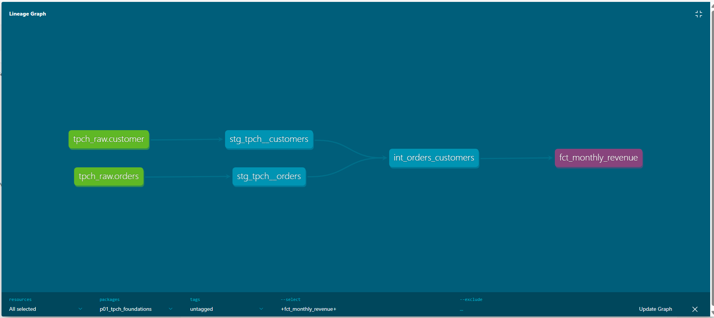
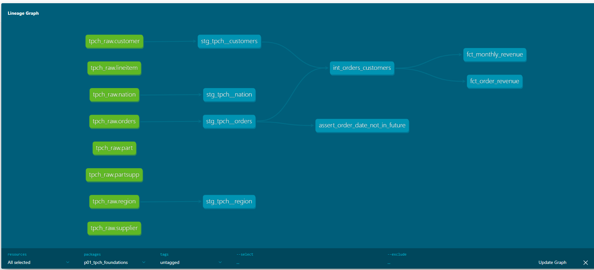
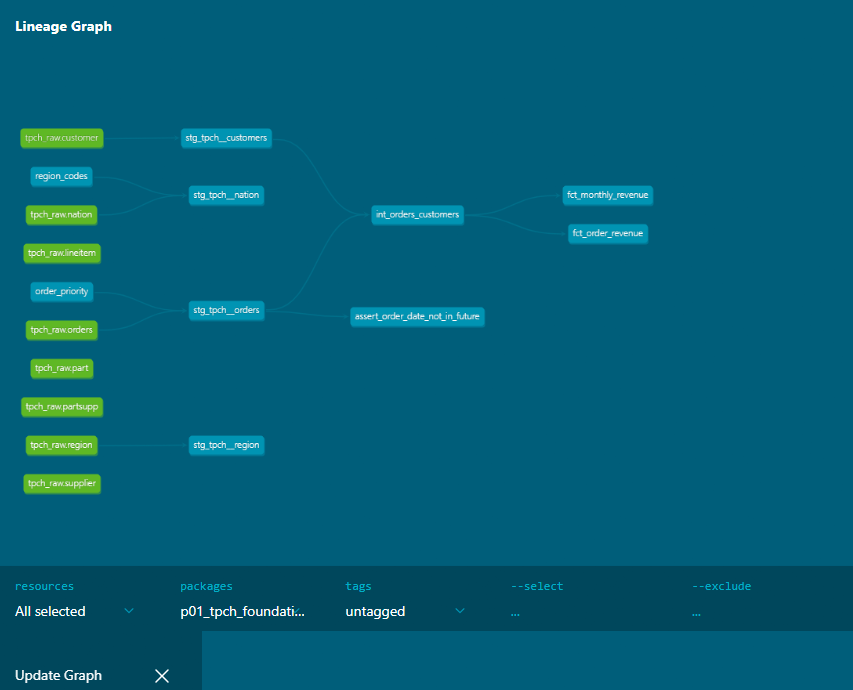
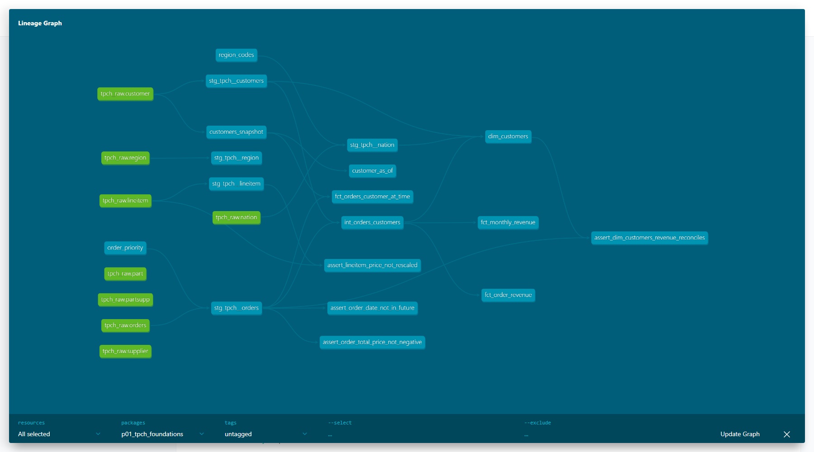

# P01 · Project context

The [README](README.md) says what the project *is* and how to run it. This page says **how it was built, in what order, and what it was built from**.

## Why this project exists

A dbt learning project for analytics-engineering work. The goal was more than copying a tutorial: follow a public series, then check every step against the data, and keep the bugs found along the way. Everything runs locally on DuckDB with generated TPC-H data, so anyone can clone it and reproduce it with no accounts or credentials.

## How it was built

One series part per branch and pull request, small commits, nothing built ahead of the part in progress.

| Step | What was added | PR | Lineage |
|---|---|---|---|
| Part 2 | uv project, TPC-H loader, `sources.yml`, first staging view | #1 | |
| Part 3 | staging models, `int_orders_customers`, `fct_monthly_revenue` | #2 |  |
| Part 4 | schema tests and descriptions, `fct_order_revenue`, first singular test | #3 |  |
| Part 5 | seeds (`region_codes`, `order_priority`) wired into staging | #4 |  |
| Part 6 | `customers_snapshot`, change simulation, `customer_as_of` analysis | #5 | |
| Part 7 | macros, `dbt_utils`, `stg_tpch__lineitem`, price guard test | #6 | |
| Part 8 | materialization per layer, ephemeral experiment | #7 | |
| README | project README, root README link | #8 | |
| Extensions | `dim_customers`, timestamp snapshot, `fct_orders_customer_at_time`, more tests | #9 |  |

Final state: `dbt build` → **PASS=65** (2 seeds, 1 snapshot, 10 models, 52 tests), checked on a fresh clone.

## Decisions worth knowing

- **Naming:** `stg_tpch__<table>` for staging, snake_case `*_id` columns. The series mixes conventions; this project picks one.
- **`profiles.yml` lives in the project folder** with a relative DuckDB path, so a fresh clone and CI work without `~/.dbt/`. DuckDB has no credentials, so nothing secret is stored.
- **Materializations per layer** (staging view, intermediate view, marts table), each with a reason in `dbt_project.yml`. `int_orders_customers` was tried as `ephemeral` and kept as a view.
- **Snapshots read the raw source**, not staging, so later staging changes can't rewrite recorded history.
- **Timestamp strategy:** the first snapshot used `check`. Its version dates were the day `dbt snapshot` ran (2026), so it could never join to 1992–1998 orders. The loader now adds `c_updated_at` and the snapshot uses `timestamp`.
- **`dim_customers` starts from customers, not orders**, so all 15,000 customers appear, including the 5,000 who never ordered.

## Where Claude helped

Built as a pair with Claude Code acting as a teaching partner. I wrote `fct_monthly_revenue` and `dim_customers` (including the window function) myself, from hints. Claude wrote the timestamp-snapshot redesign, `fct_orders_customer_at_time`, and the `dim_customers` and negative-price tests; those are marked "Written by Claude" in the code and commit messages. Some older commits carry a `Co-Authored-By: Claude` trailer.

## Resources followed

**The series**
- Parts 2–8 of the dbt + DuckDB + TPC-H series by @lhungen on Medium: <https://medium.com/@lhungen>. Followed closely, then adapted. Five issues found along the way are written up in the [README](README.md#traps-found-while-following-the-tutorial).

**Official documentation**
- dbt: [sources](https://docs.getdbt.com/docs/build/sources) · [data tests](https://docs.getdbt.com/docs/build/data-tests) · [seeds](https://docs.getdbt.com/docs/build/seeds) · [snapshots](https://docs.getdbt.com/docs/build/snapshots) · [materializations](https://docs.getdbt.com/docs/build/materializations) · [Jinja and macros](https://docs.getdbt.com/docs/build/jinja-macros) · [packages](https://docs.getdbt.com/docs/build/packages)
- [dbt-duckdb adapter](https://github.com/duckdb/dbt-duckdb)
- [dbt_utils](https://github.com/dbt-labs/dbt-utils) (`generate_surrogate_key`)
- [DuckDB TPC-H extension](https://duckdb.org/docs/stable/core_extensions/tpch) and the [TPC-H specification](https://www.tpc.org/tpch/) (the source of the `order_status` meanings)
- [uv](https://docs.astral.sh/uv/)
