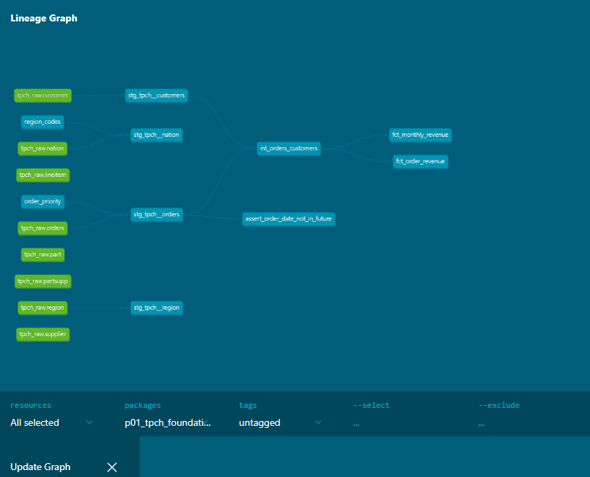

# P01 · TPC-H Foundations

A dbt project on DuckDB that turns the TPC-H benchmark data into tested, documented models, from raw tables through staging and intermediate layers to marts. It follows a public dbt + DuckDB tutorial series, adapted to one consistent naming convention, with a few tutorial bugs found and fixed along the way.

**Stack:** dbt-core 1.12 · dbt-duckdb 1.11 · dbt_utils 1.4 · DuckDB · uv
**Data:** TPC-H at scale factor 0.1 (150,000 orders, 600,572 order lines, 15,000 customers), generated locally

## Business questions

1. **How does booked order value move month by month, by customer market segment?** → `fct_monthly_revenue`
2. **Who are the highest-value customers?** → `fct_order_revenue`
3. **What did a customer look like at a given moment?** (segment, balance, address) → `customers_snapshot` + `analyses/customer_as_of.sql`

## Approach

```
sources (tpch_raw) ─┐
seeds (lookups) ────┴─► staging (views) ─► intermediate (view) ─► marts (tables)
                                                    snapshot (SCD2 on raw customers)
```

| Layer | Models | Rule |
|---|---|---|
| **Staging** (view) | `stg_tpch__orders`, `__customers`, `__nation`, `__region`, `__lineitem` | One source each. Rename and type only; no filters. The only joins are small seed lookups. |
| **Intermediate** (view) | `int_orders_customers` | Orders left-joined to customers, so every order survives (150,000 in = 150,000 out). |
| **Marts** (table) | `fct_monthly_revenue`, `fct_order_revenue` | Aggregations for people and BI. |
| **Seeds** | `region_codes`, `order_priority` | Small, project-owned lookups versioned in git and referenced with `ref()` so they show in the lineage. |
| **Snapshot** | `customers_snapshot` | SCD Type 2 history of the **raw** customer table, `check` strategy (TPC-H has no `updated_at`). |

Materializations are set per folder in `dbt_project.yml`, each with a one-line reason. `int_orders_customers` was tried as `ephemeral` and kept as a view: several marts read it, and a view can be queried directly when debugging.

**Grain of each mart**
- `fct_monthly_revenue`: one row per (month, market segment), 400 rows
- `fct_order_revenue`: one row per customer **who has ordered**, 10,000 rows (TPC-H gives one in three customers no orders)



## Tests

`dbt build` → **PASS=56, WARN=0, ERROR=0** (2 seeds, 1 snapshot, 8 models, 45 tests)

| Test | Count | Guards against |
|---|---|---|
| `not_null` | 31 | missing keys and measures; null lookups after a left join |
| `unique` | 8 | duplicate rows on every primary key, including the `line_item_id` surrogate key |
| `relationships` | 3 | orders without a customer, lines without an order, priority codes missing from the seed |
| `accepted_values` | 1 | unexpected `order_status` values (severity **warn**: a quality signal, not a reason to stop) |
| `assert_order_date_not_in_future` | 1 | orders dated in the future |
| `assert_lineitem_price_not_rescaled` | 1 | someone applying a cents-to-dollars conversion to prices that are already dollars |

Every column has a description that says what it holds and what a downstream user needs to know (units, inclusions, exclusions).

## Traps found while following the tutorial

1. **A status code was mislabelled, and it skewed a revenue metric.** The tutorial treats `order_status = 'P'` as *pending* and filters it out of revenue. Writing the column description showed that in TPC-H, **P = partially shipped** (F = fully shipped, O = open). Status is a function of order date: up to 1994 every order is F, from 1996 every order is O, and every P order is in 1995. The filter wasn't removing a category, it was cutting a hole in mid-1995 (April 1995: 572 orders instead of 1,880). **Fix:** no status filter; the measure is called `total_order_value` (booked order value, all statuses).

2. **A macro would have cut revenue 100× with no error.** The tutorial applies `cents_to_dollars` to `l_extendedprice`. TPC-H prices are already dollars (`DECIMAL(15,2)`, 901.00 to 95,949.50). Applied on purpose to check: the build passed and total line value fell from **$21.6B to $216M**. **Fix:** the macro is kept for learning but not applied, and `assert_lineitem_price_not_rescaled` fails on all 600,572 lines if it ever is.

3. **The point-in-time snapshot query returned nothing.** The tutorial filters `dbt_valid_from >= start and dbt_valid_to <= end`. Current versions have `dbt_valid_to = NULL`, which fails every comparison, so it returned **0 rows**. **Fix:** `dbt_valid_from <= as_of and (dbt_valid_to > as_of or dbt_valid_to is null)`, verified before, between and after two snapshot runs.

4. **Inconsistent names across the series** (`stg_orders` vs `stg_tpch__orders`, `order_key` vs `order_id`). This project uses one convention: `stg_tpch__<table>`, snake_case `*_id` columns. `strip_prefix` gives `orderkey` and `extendedprice`, so it's only used where the stripped name is already right.

5. **Seed CSV values with leading spaces.** The tutorial's CSV has spaces after commas (`1, America`), which stores `' America'` and silently breaks joins. The seeds here have none, and their column types are pinned.

**Also learned the hard way**
- Switching a model to `ephemeral` doesn't drop its old view. The stale view kept answering queries until dropped by hand.
- A `check` snapshot only watches its `check_cols`: a phone change was missed and the snapshot kept the old phone. A change made and reverted between two runs leaves no trace.
- DuckDB / dbt-duckdb have no `materialized_view`; marts stay tables.
- The region seed is a learning exercise: TPC-H already has a `region` table with names.

## How to run

From this folder:

```bash
uv sync                               # install dbt from uv.lock
uv run python scripts/load_tpch.py    # generate TPC-H into tpch.duckdb (git-ignored)
uv run dbt deps                       # install dbt_utils from package-lock.yml
uv run dbt build                      # seeds, snapshot, models and tests, in DAG order
```

`profiles.yml` lives in this folder (not `~/.dbt/`) with a relative DuckDB path, so a fresh clone and CI work without setup. DuckDB has no credentials, so nothing secret is stored. Run dbt commands from this folder, or dbt looks for `~/.dbt/` and fails.

Optional:
```bash
uv run python scripts/simulate_customer_changes.py   # change 5 raw customers, then:
uv run dbt snapshot                                   # record their history
uv run dbt compile --select customer_as_of --vars "{as_of: '2026-11-11 18:40:00'}"
uv run dbt docs generate && uv run dbt docs serve     # lineage and column docs
```

## What I learned

- **Documenting a column is how you find out what it means.** The status-code bug only surfaced while writing a description.
- **State the grain of every model.** "One row per customer" vs "one row per customer who has ordered" is a 5,000-row difference.
- **A build that passes can still be wrong.** The cents conversion and the snapshot query both ran without errors; tests and reconciliation counts caught them.
- **Don't paste tutorial code as-is.** Check it against the project's names, the data's units and the logic first.
